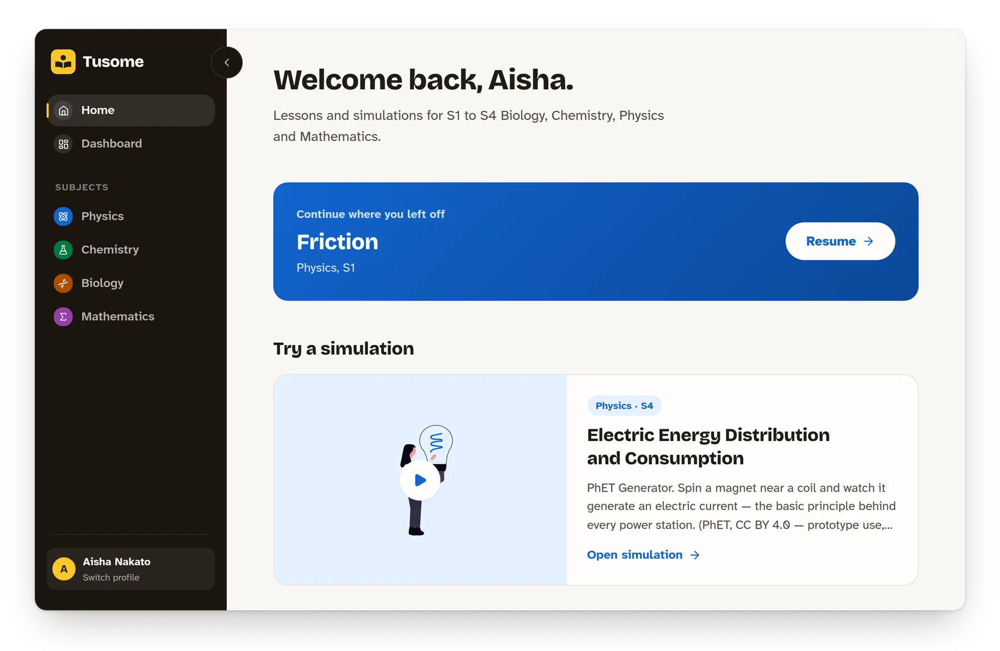
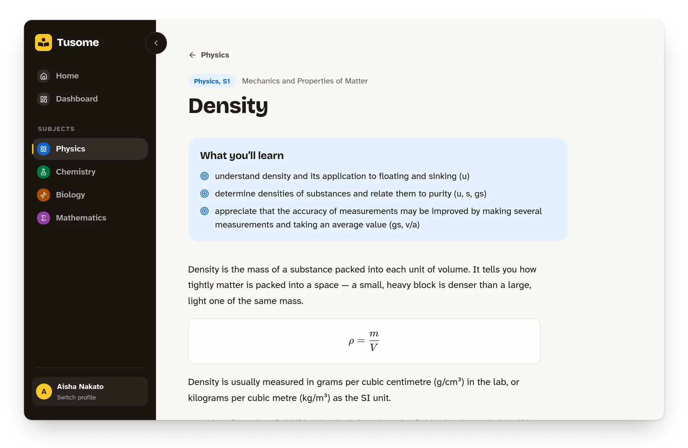
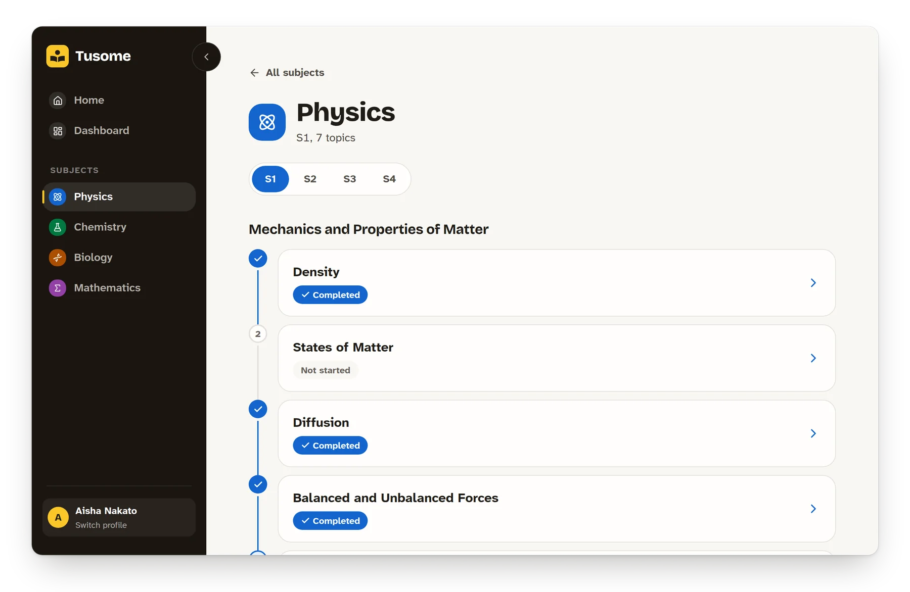
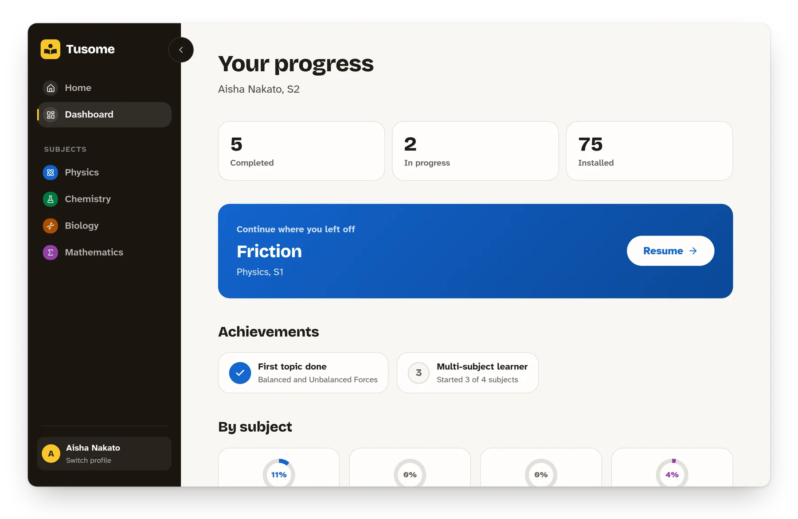
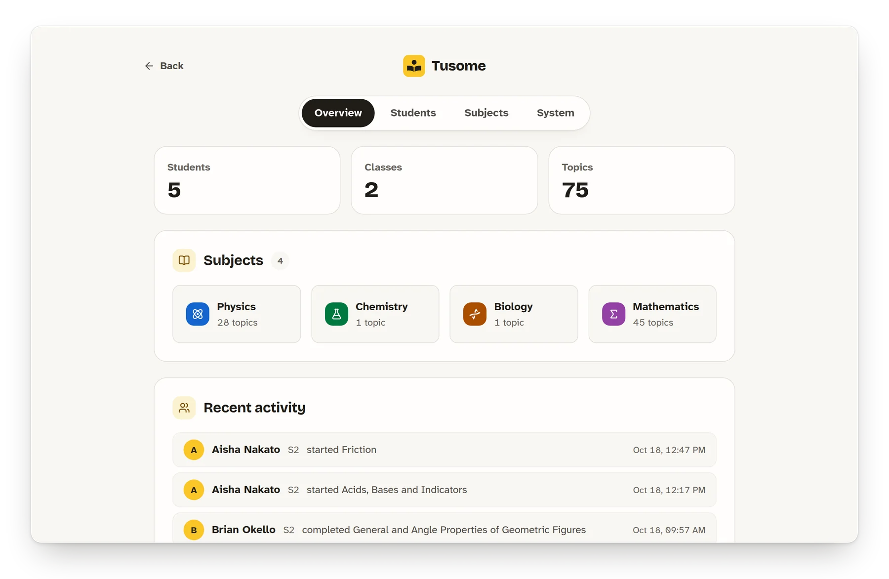

<!-- Badges are static because the repo is private and shields.io can't read
     it. Bump the release badge with each release, or switch to dynamic
     badges (img.shields.io/github/v/release/abenable/Tusome) once public. -->

<div align="center">

<picture>
  <source media="(prefers-color-scheme: dark)" srcset=".github/assets/banner-dark.svg">
  
</picture>

<br>
<br>

**An offline desktop app for lower-secondary science and maths in Uganda.**<br>
Every S1–S4 topic in the new curriculum, read-aloud, PhET simulations and a projector mode, on shared school computers with no internet.

<br>

[](https://github.com/abenable/Tusome/actions/workflows/build.yml)
[](https://github.com/abenable/Tusome/releases/latest)
[](https://github.com/abenable/Tusome/releases/latest)


[](https://tauri.app)
[](https://react.dev)
[](https://www.typescriptlang.org)
[](https://www.rust-lang.org)
[](https://tailwindcss.com)
[](https://sqlite.org)
[](https://bun.sh)

<br>

[**Download**](https://github.com/abenable/Tusome/releases/latest) ·
[Features](#features) ·
[Screenshots](#screenshots) ·
[Quick start](#quick-start) ·
[Content packs](#content-packs) ·
[Updates and signing](#updates-and-signing)

<br>



</div>

<br>

## Why Tusome

Most school computers in Uganda are shared, old and offline. Tusome is built
for exactly that room: it installs once, runs without a network, keeps each
student's progress on the machine, and is designed to be read off a projector
at the back of a classroom. *Tusome* is Swahili for "let's read".

> [!NOTE]
> **Status: pilot-ready prototype.** All 139 topics follow the official NCDC
> syllabi, with outcomes quoted verbatim, but the lessons are first drafts and
> need review by Ugandan teachers. See [Status and limitations](#status-and-limitations).

## Features

<table>
<tr>
<td width="50%" valign="top">

### The whole syllabus, term by term
All 139 S1–S4 topics in biology, chemistry, physics and maths, laid out the
way the NCDC programme planner runs the year: class, then term. Each lesson
has worked examples, activities with everyday materials and discussion prompts.

</td>
<td width="50%" valign="top">

### Read aloud
Any lesson can be read aloud, sentence by sentence with the sentence
highlighted, at normal or slower speed. Equations and units are spoken
properly ("density equals mass divided by volume").

</td>
</tr>
<tr>
<td valign="top">

### Presenter mode
One screen and sixty learners is the usual classroom, so every lesson opens
as full-screen slides with large type. Arrow keys and clickers step through
it; simulations fill the screen.

</td>
<td valign="top">

### Computer labs
Run each PC on its own, or make one PC the lab server so learners' progress
follows them to any computer. Lab traffic is encrypted with a code the
teacher types once per PC.

</td>
</tr>
<tr>
<td valign="top">

### 43 PhET simulations
Interactive HTML5 sims from [PhET](https://phet.colorado.edu/), bundled and
pinned to exact versions, plus a native TypeScript sim engine for custom ones.

</td>
<td valign="top">

### Made for shared machines
Learners pick their class and profile and sign in with a password, and are
signed out after 15 idle minutes. Guest mode lets anyone practise without
saving. No marks, no tests: learning without pressure.

</td>
</tr>
<tr>
<td valign="top">

### A teacher area
PIN-protected: a student register with password resets, a one-click move
up a class for the new school year, and backups of every learner's progress.

</td>
<td valign="top">

### Updates that don't interrupt
Each PC checks online after it starts and downloads new versions quietly.
New versions bring new lessons. Nothing installs until someone presses
**Restart to update**.

</td>
</tr>
</table>

## Screenshots

<table>
<tr>
<td width="50%"></td>
<td width="50%"></td>
</tr>
<tr>
<td align="center"><sub><b>Lessons</b> with outcomes, equations and a simulation</sub></td>
<td align="center"><sub><b>Learning paths</b> that fill in as students finish topics</sub></td>
</tr>
<tr>
<td width="50%"></td>
<td width="50%"></td>
</tr>
<tr>
<td align="center"><sub><b>Student dashboard</b> with progress by subject</sub></td>
<td align="center"><sub><b>Teacher area</b> with class activity at a glance</sub></td>
</tr>
</table>

## Download

Grab the installer for your system from the
[latest release](https://github.com/abenable/Tusome/releases/latest).

| System | File |
| --- | --- |
| Windows 10 and 11 | `Tusome_<version>_x64-setup.exe` (or the `.msi`) |
| Ubuntu, Debian and derivatives | `Tusome_<version>_amd64.deb` |

The installers aren't code-signed yet, so Windows SmartScreen may warn on
first run. Choose **More info**, then **Run anyway**.

## Quick start

You need [Rust](https://rustup.rs/) (stable), [Bun](https://bun.sh/) 1.4 or
newer, and the [Tauri prerequisites](https://tauri.app/start/prerequisites/)
for your system (WebView2 on Windows, `libwebkit2gtk` on Linux).

```sh
bun install          # dependencies
bun run fetch:sims   # download and checksum-verify the 43 PhET sims
bun tauri dev        # run the desktop app
```

The sim files are third-party artifacts, so they're gitignored. The fetch
script makes them reproducible, and release builds run it automatically.

```sh
bun tauri build      # installers: .deb on Linux, .exe and .msi on Windows
bun test             # frontend tests
bun run validate:content     # check every content pack (CI runs this too)
cd src-tauri && cargo test   # Rust tests, including update signing and lab mode
```

<details>
<summary><b>Project layout</b></summary>

```
src/                     React frontend: routes, components, content loader, sims
src-tauri/               Rust shell: plugins, commands, migrations, update core
src-tauri/examples/      make_bundle.rs, the content-bundle signing tool
content/<subject>/       JSON content packs, one folder per topic
content/sims/            PhET sims (gitignored) and phet-manifest.json (tracked)
scripts/                 fetch-phet-sims.ts, autobuild.sh
.github/                 CI release workflow and README assets
```

</details>

<details>
<summary><b>Stack</b></summary>

Tauri 2, React 19, TypeScript 7, Vite 8, TanStack Router and Query,
Tailwind CSS 4, shadcn/Base UI, SQLite through `tauri-plugin-sql`, and Bun
as package manager and test runner. Type is set in Bricolage Grotesque and
Atkinson Hyperlegible Next, both self-hosted.

</details>

## Content packs

A pack lives at `content/<subject>/<topic>/pack.json` and carries topic
metadata (including its `term`), learning outcomes quoted verbatim from the
NCDC syllabus, body blocks and an optional simulation. Blocks are `text`,
`heading`, `list`, `equation` (LaTeX plus a `speech` string for read-aloud),
`example` (a worked example in steps), `callout` (`activity`, `think` or
`remember`) and `image`. The schema is in
[`src/content/schema.ts`](src/content/schema.ts); an app that meets a block
type it doesn't know skips it rather than dropping the lesson. A simulation
reference is one of:

```jsonc
{ "sim": { "simId": "projectile", "params": { "speed": 20 } } }   // custom TypeScript sim
{ "sim": { "phet": "circuit-construction-kit-dc_en.html" } }      // bundled PhET sim
```

PhET sims are pinned to exact versions in
[`content/sims/phet-manifest.json`](content/sims/phet-manifest.json). To
upgrade one, bump its `version` and re-pin its `sha256`.

## Updates and signing

Each PC checks for a new version about 30 seconds after it starts (teachers
can turn this off in Settings), downloads it in the background, and shows
**Restart to update** in the sidebar. Nothing installs until someone presses
it. New versions carry new lessons, so this is also how content reaches
schools. A USB stick still works for PCs that never go online.

For installed copies to find updates, two things must be true:

1. **Releases are signed.** Add the signing key as repo secrets
   `TAURI_SIGNING_PRIVATE_KEY` (the contents of `~/.tusome/tusome.key`) and
   `TAURI_SIGNING_PRIVATE_KEY_PASSWORD`. CI then signs every installer and
   publishes `latest.json` with each tagged release.
2. **Releases are public.** The app sends no credentials, so it can't read a
   private repo's releases. Make this repo public, or publish releases to a
   public one and change `endpoints` in `tauri.conf.json`.

<details>
<summary><b>How signing works</b></summary>

One minisign keypair signs both app updates and content bundles. Every
installed copy trusts only its public key (`CONTENT_PUBKEY` in
`src-tauri/src/updates.rs` and `plugins.updater.pubkey` in
`src-tauri/tauri.conf.json`, key id `CE13264ADFC1E91D`).

- **Private key:** `~/.tusome/tusome.key`. Keep the password in a password
  manager and an offline backup of the key. If the key is lost, no installed
  school machine can ever take another update.
- **Rotating the key** means shipping one release, signed with the old key,
  that carries the new public key.

</details>

<details>
<summary><b>Building a content bundle</b></summary>

```sh
export TAURI_SIGNING_PRIVATE_KEY=~/.tusome/tusome.key
export TAURI_SIGNING_PRIVATE_KEY_PASSWORD=...   # from your password manager
bun run bundle:content
```

This writes `dist-bundle/tusome-updates/` (copy it to the root of a USB
stick) and `dist-bundle/bundle.zip` (attach it to a GitHub release for the
online channel). The tool refuses to finish unless the bundle verifies
against the app's public key and installs cleanly into an empty folder.

</details>

## Status and limitations

- **Lessons need teacher review.** They were drafted from the official NCDC
  syllabi with AI assistance. Outcomes are verbatim and every calculation
  was checked, but the explanations, local examples and facts need a pass by
  Ugandan teachers before classroom use. There are no images yet.
- **Online updates need setup.** See [Updates and signing](#updates-and-signing):
  signing secrets and a public release host.
- **Read-aloud voices depend on the PC.** Windows uses its installed voices
  (British English if available). Ubuntu's webview has no speech, so Linux
  uses speech-dispatcher, which sounds robotic.
- **Lab mode needs the network allowed.** Windows asks once whether Tusome
  may use the network on the lab server; choose Allow. Clients find the
  server by broadcast, or by typing its address.
- **Not yet tested on target hardware.** Performance, WebView2 availability
  and projector legibility still need checking on real school machines.
- **PhET licence pending.** Sims are used under CC BY 4.0 for prototyping
  while a partnership licence is arranged.

## Credits and licence

- **Simulations:** [PhET Interactive Simulations](https://phet.colorado.edu/),
  University of Colorado Boulder, CC BY 4.0. Don't redistribute the sim files
  without the partnership licence.
- **Fonts:** [Bricolage Grotesque](https://github.com/ateliertriay/bricolage)
  and [Atkinson Hyperlegible Next](https://github.com/googlefonts/atkinson-hyperlegible-next),
  SIL Open Font License.
- **Icons:** [Lucide](https://lucide.dev), ISC. **Illustrations:**
  [unDraw](https://undraw.co).
- **Source code:** not licensed yet (there's no `LICENSE` file), so default
  copyright applies.

<br>

<div align="center">
<sub>Made for Ugandan classrooms. <a href="#readme">Back to top</a></sub>
</div>
